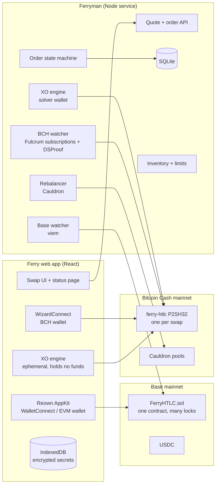

# Ferry — Engineering Blueprint

**A ferry, not a bridge.** To our knowledge, Ferry is the **first live, two-way, stablecoin swap between Bitcoin Cash and another chain** (prior art in §22). Two-way, trust-minimised swaps between **USDC on Base** and **PUSD / MUSD on Bitcoin Cash**. Nothing is wrapped, minted or held by a custodian. Each swap is two hash-time-locked contracts (HTLCs), one per chain, that unlock with the same 32-byte secret.

| | |
|---|---|
| Event | BCH BLAZE 2026: hacking 14 Nov 14:00 UTC → 22 Nov 14:00 UTC; showcase 28 Nov |
| Targets | Mainnet Track · Stablecoin Bridge bounty ($750 PUSD) · Build with XO bounty (0.3 BCH × 10) |
| Document status | Design v1.0, 22 Oct 2026. Pre-implementation. |
| Lineage | Merges *Hashport* (architecture, XO leg, solver) and *StablePort* (two-way core, recovery discipline), with the fixes from the engineering review |

> **Rules note (verified on the DoraHacks detail page, 22 Oct).** Pre-existing work is allowed, but must be disclosed in the homepage banner with links to the **old repo, the new repo, and a demo of the project as it stood before the hackathon began**. Projects must also be "original or significantly improved during the hackathon". This blueprint therefore uses a **disclosed foundation** strategy (§12, Phase 0): contracts and feasibility spikes are built before kick-off in a public repo, frozen at tag `pre-blaze`, and disclosed. The product (solver, app, mainnet, MUSD, polish) is built during 14–22 Nov.
>
> **Submission window (DoraHacks timeline, UTC):** opens **13 Nov 13:00**; hard deadline **22 Nov 14:00**. Judging runs 23–27 Nov; winners are announced 28 Nov.

---

## Table of contents

1. Requirements
2. System overview
3. Swap protocol
4. Timelock and confirmation safety
5. Module specifications
6. Tech stack and pinned versions
7. Environment setup
8. Configuration
9. Security and threat model
10. Feasibility assessment
11. Test plan and empirical spikes
12. Build timeline
13. Demo plan
14. Eligibility and bounty checklist
15. Open questions for sponsors
16. Risk register
17. After the event
18. Appendix: canonical data
19. Judging criteria alignment
20. Frontend design system (theme + liquid glass)
21. Solver inventory sizing
22. Positioning and prior art
23. Pay links
24. Multi-chain support (BCH as the hub)

---

## 1. Requirements

### 1.1 Functional

| ID | Requirement | Source |
|---|---|---|
| FR-1 | Swap USDC (Base) → PUSD (BCH) | Bridge bounty: "other-chain stables into BCH stables" |
| FR-2 | Swap PUSD (BCH) → USDC (Base) | Bridge bounty: "and vice-versa" |
| FR-3 | Same two directions for MUSD | Bounty stretch goal: "supporting multiple [BCH stablecoins] would be better" |
| FR-4 | BCH wallet connection via WizardConnect | Bounty "highly recommended"; Mainnet Track requirement (F010) |
| FR-5 | EVM wallet connection via WalletConnect | Bounty "probably essential" |
| FR-6 | Every swap ends in exactly one of: *completed*, or *both sides refunded*. No third outcome. | Core safety property |
| FR-7 | A user can finish (claim or refund) **without the Ferry website or solver**, using a downloadable recovery file | Liveness |
| FR-8 | The BCH HTLC is expressed as a functional **XO template** and its invitations are inspected in the XO debug tool | Build with XO bounty |
| FR-9 | Live status page per swap, with explorer links for every transaction on both chains | Demo, trust |
| FR-10 | **Pay links**: a BCH user shares a link, and anyone pays them in PUSD/MUSD from USDC or USDT on any supported chain (§23) | Product depth, business case |
| FR-11 | Seven counterpart networks, each with five chains per stablecoin. **USDC:** Base, Ethereum, Arc, Arbitrum, Solana. **USDT:** Tron, Ethereum, Arbitrum, Solana, BSC. USDC ships first. **Every route has Bitcoin Cash on one side** (§24) | Bounty: "multiple/any other ecosystems would be even better" |

### 1.2 Non-functional

| ID | Requirement | Target |
|---|---|---|
| NFR-1 | Forward swap wall time, fast lane (≤ `ZERO_CONF_MAX_USD`) | < 60 s median |
| NFR-2 | Forward swap wall time, safe lane | ~1 BCH block (≈10 min median) + < 60 s |
| NFR-3 | User-side fees (excluding spread) | < $0.05 per swap |
| NFR-4 | Solver crash at any state → no loss of funds; resumes from DB plus chain rescan | Required |
| NFR-5 | No admin keys, upgradeability or pause function on either contract | Required |
| NFR-6 | The secret never appears in a URL, log line or analytics event | Required |

### 1.3 Out of scope

Routes that don't touch Bitcoin Cash (e.g. Base ↔ Solana) · USDT on Base or Arc, and USDC on Tron or BSC · multi-solver auctions · THORChain or ShapeShift routing (pursued as outreach, §17) · minting or redeeming PUSD or MUSD through the protocols · loan positions.

---

## 2. System overview

### 2.1 Components



### 2.2 Naming

| Thing | Name |
|---|---|
| Product and web app | **Ferry** |
| Solver service | **Ferryman** |
| XO template | `ferry-htlc` |
| EVM contract | `FerryHTLC` |
| Packages | `@ferry/core`, `@ferry/htlc-bch`, `@ferry/htlc-evm`, `@ferry/solver`, `@ferry/web` (check npm scope availability; fall back to `@ferryswap/*`) |

### 2.3 Key design decisions

1. **The user is always the initiator.** The user generates the secret, locks first, and gets the longer timeout in both directions. The user never has to trust the solver's software for safety; they only rely on its liquidity.
2. **The BCH contract is a covenant with fixed payees.** Both branches force the output to a locking bytecode fixed in the contract. The claim needs only the preimage, with no signature. Consequences:
   - Anyone can broadcast the claim or refund. Watchtowers and the solver can finish a swap for the user, and funds can still only go to the right party.
   - The browser's XO engine never holds funds, so there is no ephemeral-key custody problem (the Hashport and Tab weakness).
   - WizardConnect only needs to provide an address (forward) and fund one output (reverse). It never has to sign a custom script input, which removes the largest wallet-compatibility unknown.
3. **The EVM contract mirrors this.** `claim()` and `refund()` are permissionless and pay fixed recipients.
4. **BCH refund locks use block height, never time.** BCH CLTV compares time-based locks to median-time-past, which lags wall-clock time by about an hour.
5. **The preimage is exactly 32 bytes on both chains.** A length mismatch between chains is a classic HTLC bug that can make one side unclaimable.
6. **One BCH script per swap; one EVM contract for all swaps.** On BCH the swap terms are constructor parameters, so each swap gets its own P2SH32 address. That gives clean watching, and a public commitment to the terms.

---

## 3. Swap protocol

### 3.1 Order terms (canonical object)

```ts
type Direction = "EVM_TO_BCH" | "BCH_TO_EVM";

interface OrderTerms {
  version: 1;
  direction: Direction;
  bchToken: "PUSD" | "MUSD";
  bchTokenCategory: Hex32;          // display byte order
  bchTokenAmount: bigint;           // base units (2 decimals)
  usdcAmount: bigint;               // base units (6 decimals)
  evmChainId: 8453;                 // Base mainnet
  evmHtlc: Address;                 // FerryHTLC deployment
  userEvmAddress: Address;
  userBchLockingBytecode: Hex;      // P2PKH from the WizardConnect receive address
  solverEvmAddress: Address;
  solverBchLockingBytecode: Hex;
  hashLock: Hex32;                  // sha256(secret), secret is 32 bytes
  evmDeadline: number;              // unix seconds
  bchRefundHeight: number;          // absolute block height
  bchCarrySats: bigint;             // BCH carried in the HTLC UTXO, pays the claim/refund fee
  bchMaxFee: bigint;
  quoteId: string;
  quoteExpiry: number;
}
```

- `orderId = sha256(canonicalCBOR(terms))`.
- The solver signs `orderId` (secp256k1, EIP-191 personal sign with the solver's EVM key). The user verifies the signature before locking anything.

### 3.2 Forward: USDC → PUSD (EVM_TO_BCH)

```mermaid
sequenceDiagram
  autonumber
  participant U as User (browser)
  participant S as Ferryman
  participant B as Base / FerryHTLC
  participant C as BCH / ferry-htlc
  U->>U: secret ← 32 random bytes; H = sha256(secret)
  U->>S: quote request (amount, PUSD, user addresses, H)
  S-->>U: signed terms (evmDeadline = now+24h, bchRefundHeight = tip+36)
  U->>U: save encrypted secret + recovery file
  U->>S: sign permit + LockIntent (EIP-712, no gas)
  S->>B: lockWithIntent(user, USDC, recipient=solver, H, evmDeadline)  [relayed]
  S->>B: observe Locked; wait EVM_CONFS
  S->>S: check terms, inventory, timing invariant (§4)
  S->>C: fund ferry-htlc(recipient=user, refund=solver, H, height)  [XO lock action]
  U->>C: observe lock; verify script hash = expected; wait reveal policy (§4.3)
  U->>C: claim(secret) → PUSD to user's address  [XO claim action, no signature]
  U->>S: POST /orders/:id/secret  (cooperative, optional)
  S->>C: (sees secret in mempool or from POST)
  S->>B: claim(id, secret) → USDC to solver
```

### 3.3 Reverse: PUSD → USDC (BCH_TO_EVM)

```mermaid
sequenceDiagram
  autonumber
  participant U as User (browser)
  participant S as Ferryman
  participant B as Base / FerryHTLC
  participant C as BCH / ferry-htlc
  U->>U: secret, H
  U->>S: quote request
  S-->>U: signed terms (bchRefundHeight = tip+144, evmDeadline = now+6h)
  U->>C: fund ferry-htlc(recipient=solver, refund=user, H, height)  [WizardConnect-signed send]
  S->>C: observe; wait BCH reveal policy for *user's* lock (§4.3)
  S->>B: lock(USDC, recipient=user, H, evmDeadline)
  U->>B: observe; wait EVM_CONFS
  U->>B: claim(id, secret) → USDC to user  (or relayed, see 5.4)
  S->>B: read Claimed(id, secret) event
  S->>C: claim(secret) → PUSD to solver
```

### 3.4 Abort paths

| Situation | Outcome |
|---|---|
| Solver never locks (either direction) | The user refunds after their own timeout. Permissionless, so anyone, including the recovery page, can trigger it. |
| User never claims after the solver locks | The solver refunds after its shorter timeout. The user's lock then refunds after the longer timeout. |
| User claims, solver offline | The secret is public on chain. Ferryman catches up on restart. Margins (§4) give it hours to claim. |
| Quote expires before the user locks | No funds move. The solver rejects late locks: Ferryman refuses to counter-lock and the user refunds. The UI blocks locking after expiry. |

### 3.5 Pricing

- `out = in × (1 − SPREAD_BPS / 10_000) − FIXED_FEE`, converted between 6 and 2 decimals with **floor** rounding in the solver's favour. The rounding is disclosed in the quote.
- **Peg guard:** the solver refuses to quote if `|pusdUsdPrice − 1| > PEG_TOLERANCE`, using the Paryon stats API, or if the Cauldron spot price for the token disagrees by more than the tolerance. For MUSD, only the Cauldron spot is used.
- A quote is valid for `QUOTE_TTL_S`, and is capped by `MAX_SWAP_USD` and by solver inventory minus open exposure.

---

## 4. Timelock and confirmation safety

### 4.1 Invariants

Let `t₀` be the moment the solver counter-locks. Write `ΔBCH(n)` for the wall time BCH needs to produce `n` blocks (≈ n × 10 min, Poisson-distributed, with the ASERT difficulty adjustment pulling it back to target).

**Forward (user locks on Base, solver locks on BCH)**

- The solver's BCH refund opens at height `t₀_height + N_fwd`.
- Worst case for the solver: the user claims on BCH just as the refund opens. The secret becomes public at about `t₀ + ΔBCH(N_fwd)`.
- The solver must then claim on Base before `evmDeadline`.
- **Invariant F:** `evmDeadline − t₀ ≥ P99.99[ΔBCH(N_fwd)] + SOLVER_REACTION + SAFETY`.
- Default values: `N_fwd = 36` (≈6 h expected); evmDeadline = lock + 24 h; checked at t₀ with `SAFETY = 2 h`. 36 blocks taking more than 20 h would need a sustained average above 33 min per block, which is effectively impossible under ASERT outside a chain halt. **During a halt the solver stops quoting** (tip-age monitor, §5.3).

**Reverse (user locks on BCH, solver locks on Base)**

- The solver's Base refund opens at `evmDeadline = t₀ + 6 h`.
- Worst case for the solver: the user claims on Base at `evmDeadline − ε`. The solver must then claim on BCH before the user's refund height.
- **Invariant R:** time to reach `bchRefundHeight` from t₀ must be ≥ `6 h + SOLVER_REACTION + SAFETY` at P0.01 (fast blocks).
- Defaults: `N_rev = 144` (≈24 h). The solver counter-locks only if `bchRefundHeight − tip ≥ 108` (≈18 h expected). 108 blocks arriving in under 8 h would need a sustained average below 4.5 min per block, which is negligible.

Both invariants are enforced in code (`@ferry/core/timing.ts`): the solver refuses to counter-lock, and the UI refuses to claim, when they fail.

### 4.2 Claims stay valid after the deadline

Neither chain can enforce "claim only *before* height X". BCH `nLockTime` sets a lower bound only, and the EVM contract deliberately mirrors that. After a timeout both branches are valid and the first transaction to confirm wins. This is safe because of the invariants above. The UI says so plainly.

### 4.3 Reveal policy (when to expose the secret)

The secret may only be revealed after the counterparty's lock is **irreversible enough**. If it is revealed against an unconfirmed lock, the counterparty can double-spend their own lock *and* use the revealed secret to claim the other leg.

| Counterparty lock on | Amount ≤ `ZERO_CONF_MAX_USD` (fast lane) | Above (safe lane) |
|---|---|---|
| BCH | 0-conf, after a `DSPROOF_WINDOW_MS` window with no double-spend proof (Fulcrum `blockchain.transaction.dsproof.subscribe`) | ≥ 1 confirmation |
| Base | ≥ `EVM_CONFS` blocks (default 10, ≈20 s) | Same, plus the block is *safe* per the RPC's `safe` tag |

- **Fast lane is opt-in per swap.** The UI shows a one-line risk disclosure, and the cap is enforced on both client and solver.
- The same rule protects the solver in reverse: it counter-locks USDC only after the user's BCH lock meets the lane's threshold.

---

## 5. Module specifications

### 5.1 `@ferry/htlc-bch`: the BCH contract

**Reference implementation (CashScript):**

```solidity
pragma cashscript ^0.11.0;

// One instance per swap. All parameters are public on-chain once spent.
contract FerryHTLC(
    bytes32 hashLock,                 // sha256(secret)
    bytes   recipientLockingBytecode, // claim payee
    bytes   refundLockingBytecode,    // refund payee
    bytes32 tokenCategory,            // INTERNAL byte order (reversed vs display hex)
    int     tokenAmount,
    int     refundHeight,             // absolute block height (< 500,000,000)
    int     maxFee                    // sats the spend may burn as miner fee
) {
    function claim(bytes secret) {
        require(secret.length == 32);
        require(sha256(secret) == hashLock);
        require(this.activeInputIndex == 0);
        require(tx.inputs.length == 1);
        require(tx.outputs.length == 1);
        require(tx.outputs[0].lockingBytecode == recipientLockingBytecode);
        require(tx.outputs[0].tokenCategory == tokenCategory);
        require(tx.outputs[0].tokenAmount == tokenAmount);
        require(tx.outputs[0].value >= tx.inputs[0].value - maxFee);
    }

    function refund() {
        require(tx.time >= refundHeight);      // CLTV on block height
        require(this.activeInputIndex == 0);
        require(tx.inputs.length == 1);
        require(tx.outputs.length == 1);
        require(tx.outputs[0].lockingBytecode == refundLockingBytecode);
        require(tx.outputs[0].tokenCategory == tokenCategory);
        require(tx.outputs[0].tokenAmount == tokenAmount);
        require(tx.outputs[0].value >= tx.inputs[0].value - maxFee);
    }
}
```

**Notes:**
- **Byte order.** Token categories are displayed in reversed (RPC) byte order. Introspection returns internal order. Get this wrong and every claim fails. There is a test for it (BCH-U-07).
- **Fee carry.** The funding output carries `bchCarrySats` (default 3,000). The spend keeps at least `value − maxFee` (default `maxFee` 1,500). A one-input, one-output claim is about 350–450 bytes, so ≈450 sats at 1 sat/B, leaving the token output well above dust.
- **Refund transactions** must set `nLockTime ≥ refundHeight` and a non-final input sequence (`0xfffffffe`).
- **Exact `tokenAmount` equality** prevents partial or split spends. The token must be fungible only: no NFT and no capability, enforced by the category length and equality check.
- **Address:** P2SH32 token-aware cashaddr (`bitcoincash:r…`). The redeem script is roughly 200 bytes, well within limits.
- **Recovery data:** the full constructor parameters go in the recovery file, so the script can always be rebuilt.

**XO template `ferry-htlc`:** the same script transcribed to CashAssembly in the working XO schema. Schema rules from the gap analysis:
- `inputs.<i>.unlockingScript`, never `unlockingBytecode`.
- `actions.<a>.unlockingScripts`, never a root-level `unlockingScripts`.
- No `defaultOutput`.
- Variables written as `$(<var>)`.
- Serialise with `serializeTemplate`, never `JSON.stringify`.

| Template element | Content |
|---|---|
| Entities | `locker`, `claimer`, `refunder` |
| Variables | `hashLock`, `recipientLockingBytecode`, `refundLockingBytecode`, `tokenCategory`, `tokenAmount`, `refundHeight`, `maxFee`, `secret` |
| Locking script | `htlc` (CashAssembly mirror of the contract above) |
| Action `lock` (starting) | Funds one output to `htlc` with the token amount and carry sats. Signed by the `locker` wallet. |
| Action `claim` | Spends `htlc` with unlocking `<secret> <branch=claim>`. Needs no key. |
| Action `refund` | Spends `htlc` with `<branch=refund>`, setting `nLockTime = refundHeight`. Needs no key. |

**Equivalence test (BCH-E-01):** the CashScript and XO versions must produce identical locking bytecode for the same parameters. If byte-identical output is infeasible, they must give identical accept/reject results over the BCH-U test vectors. **The CashScript artifact is the source of truth; XO is the execution and coordination layer.**

### 5.2 `@ferry/htlc-evm`: `FerryHTLC.sol`

```solidity
// SPDX-License-Identifier: MIT
pragma solidity 0.8.28;

import {IERC20} from "@openzeppelin/contracts/token/ERC20/IERC20.sol";
import {IERC20Permit} from "@openzeppelin/contracts/token/ERC20/extensions/IERC20Permit.sol";
import {SafeERC20} from "@openzeppelin/contracts/token/ERC20/utils/SafeERC20.sol";
import {ReentrancyGuard} from "@openzeppelin/contracts/utils/ReentrancyGuard.sol";
import {ECDSA} from "@openzeppelin/contracts/utils/cryptography/ECDSA.sol";

contract FerryHTLC is ReentrancyGuard {
    using SafeERC20 for IERC20;

    enum State { None, Locked, Claimed, Refunded }

    struct Lock {
        address token;
        address sender;
        address recipient;
        uint256 amount;
        bytes32 hashLock;
        uint64  deadline;
        State   state;
    }

    mapping(bytes32 => Lock) public locks;

    event Locked(bytes32 indexed id, address indexed sender, address indexed recipient,
                 address token, uint256 amount, bytes32 hashLock, uint64 deadline);
    event Claimed(bytes32 indexed id, bytes32 secret);
    event Refunded(bytes32 indexed id);

    error AlreadyExists(); error NotLocked(); error BadSecret(); error TooEarly();
    error BadParams();

    // EIP-712 intent: binds a relayed lock to the owner's exact terms.
    bytes32 public constant LOCK_INTENT_TYPEHASH = keccak256(
        "LockIntent(address token,address recipient,uint256 amount,bytes32 hashLock,uint64 deadline,uint256 intentDeadline)"
    );
    bytes32 public immutable DOMAIN_SEPARATOR; // set in constructor: name "FerryHTLC", version "1", chainId, this

    // id is bound to the funds' owner so nobody can front-run a lock with the same hashLock.
    function lockId(address sender, bytes32 hashLock) public pure returns (bytes32) {
        return keccak256(abi.encode(sender, hashLock));
    }

    function lock(address token, address recipient, uint256 amount,
                  bytes32 hashLock, uint64 deadline) external nonReentrant returns (bytes32) {
        return _lock(msg.sender, token, recipient, amount, hashLock, deadline);
    }

    // Gasless lock: a relayer (Ferryman) submits the owner's EIP-2612 permit and EIP-712 intent.
    // The intent signature is essential: a permit alone authorises an amount, not a recipient,
    // so without it a malicious relayer could lock the owner's USDC to itself.
    // Replay is impossible: the id derives from (owner, hashLock) and each id is single-use.
    function lockWithIntent(address owner, address token, address recipient, uint256 amount,
                            bytes32 hashLock, uint64 deadline, uint256 intentDeadline,
                            bytes calldata intentSig,
                            uint256 permitDeadline, uint8 v, bytes32 r, bytes32 s)
        external nonReentrant returns (bytes32)
    {
        if (block.timestamp > intentDeadline) revert BadParams();
        bytes32 digest = keccak256(abi.encodePacked("\x19\x01", DOMAIN_SEPARATOR, keccak256(abi.encode(
            LOCK_INTENT_TYPEHASH, token, recipient, amount, hashLock, deadline, intentDeadline))));
        if (ECDSA.recover(digest, intentSig) != owner) revert BadParams();   // OZ ECDSA (or SignatureChecker for smart wallets)
        // try/catch: a front-run permit must not brick the lock
        try IERC20Permit(token).permit(owner, address(this), amount, permitDeadline, v, r, s) {} catch {}
        return _lock(owner, token, recipient, amount, hashLock, deadline);
    }

    function _lock(address owner, address token, address recipient, uint256 amount,
                   bytes32 hashLock, uint64 deadline) internal returns (bytes32 id) {
        if (amount == 0 || recipient == address(0) || deadline <= block.timestamp) revert BadParams();
        id = lockId(owner, hashLock);
        if (locks[id].state != State.None) revert AlreadyExists();
        locks[id] = Lock(token, owner, recipient, amount, hashLock, deadline, State.Locked);
        IERC20(token).safeTransferFrom(owner, address(this), amount);
        emit Locked(id, owner, recipient, token, amount, hashLock, deadline);
    }

    // Permissionless: funds can only go to the fixed recipient.
    function claim(bytes32 id, bytes32 secret) external nonReentrant {
        Lock storage l = locks[id];
        if (l.state != State.Locked) revert NotLocked();
        if (sha256(abi.encodePacked(secret)) != l.hashLock) revert BadSecret();
        l.state = State.Claimed;
        IERC20(l.token).safeTransfer(l.recipient, l.amount);
        emit Claimed(id, secret);
    }

    // Permissionless after the deadline: funds can only go back to the sender.
    function refund(bytes32 id) external nonReentrant {
        Lock storage l = locks[id];
        if (l.state != State.Locked) revert NotLocked();
        if (block.timestamp < l.deadline) revert TooEarly();
        l.state = State.Refunded;
        IERC20(l.token).safeTransfer(l.sender, l.amount);
        emit Refunded(id);
    }
}
```

**Notes:**
- The `bytes32 secret` parameter makes the preimage exactly 32 bytes by construction, matching the BCH side's `secret.length == 32`.
- `sha256` is the EVM precompile, matching BCH `OP_SHA256`.
- There is no owner, upgrade path or pause. The token is a parameter, but the solver and UI only accept the canonical USDC address.
- **Gas-free for users in both directions.**
  - Forward: the user signs two off-chain messages (USDC permit + lock intent), and Ferryman submits `lockWithIntent`.
  - Reverse: Ferryman relays the user's `claim`.
  - The user therefore never needs ETH on Base. Ferryman's gas costs (fractions of a cent on Base) are covered by the spread.
  - This matters because judges must be able to "simply click" and use the demo (§19).
- **USDC blocklist edge case:** if Circle blocklists the recipient, `claim` reverts and the lock is resolved by `refund` instead. If the sender is blocklisted too, funds stay in the contract. This is documented and out of our control.
- **Deployment:** deterministic CREATE2 through the canonical factory, so the address is the same on Base Sepolia and Base mainnet, and is verified on BaseScan.

### 5.3 `@ferry/solver`: Ferryman

**Responsibilities:**
- Quote and sign terms, and enforce limits and timing invariants.
- Watch both chains and drive each order's state machine.
- Hold hot keys for small inventory.
- Rebalance inventory.

**Order state machine (forward):**

```
QUOTED
  → USER_LOCK_SEEN → USER_LOCK_FINAL              (Base, EVM_CONFS)
  → SOLVER_LOCK_BROADCAST → SOLVER_LOCK_SEEN      (BCH)
  → SECRET_KNOWN                                  (mempool, chain, or POST /secret)
  → USER_CLAIM_SEEN (BCH)
  → SOLVER_CLAIM_BROADCAST → SOLVER_CLAIM_FINAL   (Base)  → DONE
Abort edges:
  QUOTED --(quoteExpiry)--> EXPIRED
  USER_LOCK_* --(invariant fails)--> REJECTED (user refunds after evmDeadline)
  SOLVER_LOCK_SEEN --(height ≥ bchRefundHeight ∧ no claim)--> SOLVER_REFUND_BROADCAST → SOLVER_REFUNDED
```

The reverse direction mirrors this with the chains swapped.

**Engineering rules:**
- **Idempotent transitions.** Every on-chain action is keyed by `(orderId, action)`. Before broadcasting, the solver checks chain state: "is this HTLC UTXO already spent?", "is `locks[id].state` already Claimed?".
- **Write-ahead:** the intent is persisted to SQLite (WAL mode) *before* broadcast, and the txid after.
- **Startup reconciliation:** every non-terminal order is re-derived from chain state. BCH uses `blockchain.scripthash.get_history` / `listunspent`; Base uses `locks(id)` plus event logs.
- **BCH watcher:**
  - `blockchain.scripthash.subscribe` on every open HTLC script hash (mempool and confirmed).
  - `blockchain.headers.subscribe` for the tip.
  - DSProof subscription on fast-lane counterparty locks.
  - Two Fulcrum servers, quorum on the tip; failover on disconnect.
- **Base watcher:** viem `watchContractEvent` plus a 15 s `getLogs` poll from the last processed block (event subscriptions drop). The RPC must support the `safe` and `finalized` tags.
- **Tip-age monitor:** if the BCH tip is older than 60 min, or Base is older than 2 min, stop quoting new orders. Open orders continue.
- **Limits:**
  - `MAX_SWAP_USD`
  - `MAX_OPEN_EXPOSURE_USD`
  - per-user rate limit (IP plus EVM address)
  - per-token inventory floor
- **Kill switch:** `QUOTING_ENABLED=false` stops new quotes. It cannot affect open swaps, and doesn't need to: refunds are permissionless.
- **Rebalancer (manual-assisted for the hackathon):** shows inventory per asset. BCH ↔ PUSD/MUSD runs through Cauldron via `@cashlab/cauldron`, triggered by the operator with slippage caps. USDC ↔ BCH is done off-protocol, outside the app.

**HTTP API:**

| Method | Path | Purpose |
|---|---|---|
| `POST` | `/v1/quotes` | Request a quote: `{direction, token, amountIn, userEvmAddress, userBchLockingBytecode, hashLock, lane}` → signed terms |
| `GET` | `/v1/orders/:orderId` | State, txids, deadlines (`quoteExpiry`, `counterDeadline`, `bchRefundHeight`), `updatedAt` (Unix timestamp in seconds) |
| `POST` | `/v1/orders/:orderId/secret` | Cooperative reveal. Accepted only once the counterparty lock meets the reveal policy; the server re-verifies it. |
| `POST` | `/v1/orders/:orderId/relay-lock` | Forward direction: submit the user's permit + EIP-712 intent via `lockWithIntent` (gas-free for the user). The server checks the intent matches the signed terms before relaying. |
| `POST` | `/v1/orders/:orderId/relay-claim` | Reverse direction: the solver broadcasts the user's Base `claim` and pays gas, recovered in the spread |
| `GET` | `/v1/health` | Tips, tip ages (`ageSeconds`), inventory, quoting flag, `timestamp` (Unix timestamp in seconds) |
| `GET` | `/v1/stats` | Summary of completed swaps, total volume, `medianFastSeconds`, quote policy, `asOf` (Unix timestamp in seconds) |
| `GET` | `/v1/orders/recent` | Recent settled swaps with `settledAt` (Unix timestamp in seconds) and `durationSeconds` |
| `GET` | `/v1/pegs` | Token peg price history with `asOf` and point timestamps `at` (Unix timestamps in seconds) |
| `POST` | `/v1/links` | Create pay link: `expiresAt` (Unix timestamp in seconds optional), returns `createdAt` (Unix timestamp in seconds) |
| `GET` | `/v1/links` | List pay links for recipient |
| `GET` | `/v1/links/:id` | Get pay link status with `createdAt` and `expiresAt` (Unix timestamps in seconds) |
| `POST` | `/v1/links/:id/quote` | Request quote for a pay link |
| `POST` | `/v1/links/:id/cancel` | Cancel pay link |
| `GET` | `/v1/metrics` | Operational metrics (exposure, unfunded quotes, tip ages, error counts, `lastConfirmedAt`, `timestamp` in Unix seconds) |
| `GET` | `/v1/operator/needs-attention` | Operator alerts and orders requiring intervention with `createdAt`, `updatedAt`, `ageSeconds`, `timestamp` in Unix seconds (requires Bearer token) |

**Time Units Specification:**
- **All timestamps** across all API request payloads and response bodies (`updatedAt`, `createdAt`, `quoteExpiry`, `counterDeadline`, `settledAt`, `expiresAt`, `asOf`, `timestamp`, `lastConfirmedAt`, `at`) are strictly **Unix timestamps in seconds** (integer seconds since Jan 1, 1970 UTC). Values ≥ `1e11` are rejected by core schemas as millisecond misuse (`unixTimestampSeconds`).
- **All durations and ages** (`ageSeconds`, `durationSeconds`, `medianFastSeconds`, `livenessAgeSeconds`) are non-negative integer seconds.


### 5.4 `@ferry/web`: the frontend

**Wallets:**
- BCH: `@wizardconnect/react`. Read the xpub **only after** session approval. Derive the receive address through `dappMgr.pubkeyState.*`; the top-level helpers are missing (F007).
- EVM: Reown AppKit and wagmi on Base.

**Reverse-direction funding:**
- The app builds an unsigned transaction: the user's PUSD UTXOs → one HTLC output with `tokenAmount` and `bchCarrySats`, plus change.
- It sends a WizardConnect sign request.
- **Fallback:** show the token-aware P2SH32 address, amount and token as a QR code for a manual wallet send. The solver detects either route, because only the output matters.

**Secrets:**
- Generated with `crypto.getRandomValues(32)`.
- Stored AES-GCM-encrypted in IndexedDB under a key from `crypto.subtle.generateKey`. The key is non-extractable and stored in the same IndexedDB.
- Never put in URLs, logs or analytics.

**Recovery file:** `ferry-<orderId>.json` contains the terms, the secret, and the contract addresses and bytecode. A standalone `recover.html` page in the repo (no build step, no backend) can be opened from disk and claims or refunds using public Electrum and Base RPC endpoints. This satisfies FR-7.

**Status page** at `/swap/:orderId`:
- A step timeline with an explorer link per transaction.
- A countdown to each deadline, in blocks and estimated time.
- A "Claim now" / "Refund now" button whenever a branch is valid.

**XO in the browser:**
- An engine instance is created with a **throwaway mnemonic**. It never holds funds; it builds and broadcasts keyless claim and refund actions.
- Invitations can be exported for the debug tool (§11.4).

### 5.5 `@ferry/core`: shared code

- `terms.ts`: canonical encoding, `orderId`, signature verification
- `timing.ts`: invariants F and R, block-time estimates, reveal-policy checks
- `bch/`:
  - script parameter encoding
  - category byte-order helpers
  - P2SH32 derivation
  - spend builders (libauth)
  - Electrum client wrapper
- `evm/`: ABI, viem helpers, lock-id derivation
- `pricing.ts`: decimal conversion with floor rounding, spread, peg guard
- **Types are shared by the solver and the web app.** Every change to the protocol lands here first.

### 5.6 Repository layout

```
ferry/
├─ package.json  pnpm-workspace.yaml  tsconfig.base.json  .env.example  LICENSE (MIT)
├─ packages/
│  ├─ core/                 # shared protocol logic, 100% unit-tested
│  ├─ htlc-bch/
│  │  ├─ contracts/FerryHTLC.cash
│  │  ├─ xo/ferry-htlc.template.ts
│  │  └─ test/              # libauth VM vectors, equivalence, chipnet integration
│  ├─ htlc-evm/             # Foundry project
│  │  ├─ src/FerryHTLC.sol
│  │  ├─ test/              # unit, fuzz, invariant
│  │  └─ script/Deploy.s.sol
│  ├─ solver/               # Ferryman
│  └─ web/                  # Vite + React app, plus public/recover.html
├─ docs/
│  ├─ PROTOCOL.md           # §3–§4 of this blueprint, kept current
│  ├─ XO_FEEDBACK.md        # written by a team member from repro logs
│  ├─ evidence/             # txids, debug-tool screenshots, test reports
│  └─ deck/                 # Widget Factory deck export
└─ .github/workflows/ci.yml # lint, typecheck, unit, forge test, chipnet smoke (manual)
```

---

## 6. Tech stack and pinned versions

**Version policy:**
- Exact pins, no ranges, in every `package.json`.
- Versions marked † come from the gap analysis of 21 Oct 2026 and must be re-checked with `npm view <pkg> versions` on 14 Nov.
- Versions marked ‡ should be resolved to the current stable release on 14 Nov and then frozen.

| Layer | Choice | Version | Why |
|---|---|---|---|
| Runtime | Node.js LTS | 22.x | Required by the XO `@next` build; avoid 21 (moria build bug per gap analysis) |
| Package manager | pnpm | 9.x | Workspaces, strict resolution |
| Language | TypeScript | 5.x ‡ | |
| BCH primitives | `@bitauth/libauth` | 3.x ‡ | VM for script tests, tx building, cashaddr |
| BCH contract | `cashc` / `cashscript` | 0.11.x ‡ | Reference contract + artifact |
| XO | `@xo-cash/engine` | `0.1.0-next.17298219321` † | `latest` (0.0.1) rejects current templates |
| XO | `@xo-cash/templates` · `@xo-cash/utils` | 0.0.11 † · 0.0.10 † | `parseTemplate`, `serializeTemplate` |
| BCH network | `@electrum-cash/network` | 4.4.8 † | Fulcrum client |
| WizardConnect | `@wizardconnect/dapp` · `@wizardconnect/react` · `@wizardconnect/core` | 0.2.2 † · 0.2.3 † · 0.2.5 † | BCH wallet link |
| Cauldron | `@cashlab/cauldron` · `@cashlab/common` | 1.0.3 † · 1.0.4 † | Solver rebalancing, price checks |
| EVM contracts | Foundry (forge, anvil, cast) · solc | stable ‡ · 0.8.28 | |
| EVM libs | OpenZeppelin Contracts | 5.x ‡ | SafeERC20, ReentrancyGuard, IERC20Permit |
| EVM client | viem · wagmi | 2.x ‡ · 2.x ‡ | |
| EVM wallet UI | `@reown/appkit` + wagmi adapter | 1.x ‡ | WalletConnect |
| Frontend | React · Vite · Tailwind | 19 · 6 · 4 | |
| Solver | Fastify · better-sqlite3 · pino · zod | stable ‡ | Small, fast, typed |
| Testing | Vitest · Playwright · forge test · Slither | stable ‡ | |
| Hosting | Static web on Cloudflare Pages; solver on a small VPS (2 vCPU / 2 GB) behind Caddy (TLS) | — | The solver must be long-lived (subscriptions), not serverless |

---

## 7. Environment setup

### 7.1 Toolchain

```bash
# Node 22 + pnpm
curl -fsSL https://fnm.vercel.app/install | bash && fnm install 22 && fnm use 22
corepack enable && corepack prepare pnpm@9 --activate

# Foundry
curl -L https://foundry.paradigm.xyz | bash && foundryup

# Slither (static analysis)
pipx install slither-analyzer

# Repo
git clone <repo> ferry && cd ferry
pnpm install --frozen-lockfile
pnpm -r build
pnpm -r test
(cd packages/htlc-evm && forge install && forge test -vvv)
```

### 7.2 XO debug tool (needed for the bounty)

```bash
git clone <xo-web-devtool repo> xo-web-devtool && cd xo-web-devtool
git checkout development          # main fails: ERESOLVE + dangling file:../engine (F005)
npm install && npm run dev
```

Record the commit hash used in `docs/evidence/`.

### 7.3 Accounts and keys

| Item | Purpose | Notes |
|---|---|---|
| Reown Cloud project ID | WalletConnect | Free tier |
| Base RPC (Alchemy / QuickNode / Base public) | Watcher and broadcasts | Must support `safe` and `finalized` tags and `eth_getLogs` ranges |
| Fulcrum endpoints (mainnet ×2, chipnet ×1) | BCH | Public servers; consider a self-hosted Fulcrum after the event |
| Solver BCH key | Hot inventory | Generated offline; `SOLVER_BCH_WIF` in a secrets manager, never in the repo |
| Solver EVM key | Hot inventory and quote signing | Separate from the deployer key |
| Deployer EVM key | Contract deployment only | Emptied after deploying |
| Test wallets | Selene + Paytaca (WizardConnect); Rabby/MetaMask desktop + mobile | One set per team member |
| Faucets | Chipnet tBCH; Base Sepolia ETH; Base Sepolia USDC (Circle faucet) | |

### 7.4 Test networks

- **BCH chipnet:** PUSD and MUSD do not exist there. Mint two fungible test categories, `tPUSD` and `tMUSD`, 2 decimals, with a CashTokens genesis script in `packages/htlc-bch/scripts/mint-test-tokens.ts`.
- **Base Sepolia:** Circle's test USDC.
- **Local:** `anvil` for EVM unit and integration work. The BCH VM runs in-process through libauth (no regtest node needed for unit tests).

### 7.5 `.env.example`

```dotenv
# --- network ---
NETWORK=mainnet                       # mainnet | testnet
ENABLED_ROUTES=usdc:base              # comma list of asset:chain; add a route only after it passes mainnet acceptance (§24.5)
BCH_ELECTRUM_URLS=wss://bch.imaginary.cash:50004,wss://fulcrum.greyh.at:50004
BCH_CHIPNET_ELECTRUM_URLS=wss://chipnet.imaginary.cash:50004
BASE_RPC_URL=
BASE_CHAIN_ID=8453
FERRY_HTLC_ADDRESS=
USDC_ADDRESS=0x833589fCD6eDb6E08f4c7C32D4f71b54bdA02913   # verify on BaseScan before use
PUSD_CATEGORY=2469acc5afa4b10cb5b5c04afb89c3a3ffd61c5da9c01e26d00951cae2a02544
MUSD_CATEGORY=b38a33f750f84c5c169a6f23cb873e6e79605021585d4f3408789689ed87f366
PARYON_STATS_URL=https://mainnet-v1.paryonusd.com

# --- solver secrets (never commit) ---
SOLVER_BCH_WIF=
SOLVER_EVM_PRIVATE_KEY=

# --- policy (see §8) ---
QUOTING_ENABLED=true
SPREAD_BPS=40
FIXED_FEE_USD=0.05
MIN_SWAP_USD=1
MAX_SWAP_USD=50                       # set per §21 tier (e.g. 5 for the minimum tier)
MAX_OPEN_EXPOSURE_USD=250             # set per §21 tier
ZERO_CONF_MAX_USD=25
QUOTE_TTL_S=60
PEG_TOLERANCE=0.01
EVM_CONFS=10
DSPROOF_WINDOW_MS=5000
FWD_BCH_REFUND_BLOCKS=36
FWD_EVM_DEADLINE_S=86400
REV_BCH_REFUND_BLOCKS=144
REV_EVM_DEADLINE_S=21600
REV_MIN_REMAINING_BLOCKS=108
BCH_CARRY_SATS=3000
BCH_MAX_FEE_SATS=1500
SKEW_MAX_BPS=50                       # inventory-aware pricing cap (§21.1)

# --- web ---
VITE_REOWN_PROJECT_ID=
VITE_SOLVER_URL=
```

---

## 8. Configuration and defaults

| Parameter | Default | Rationale |
|---|---|---|
| `MAX_SWAP_USD` | 50 | Hackathon exposure cap; raise only after an external review |
| `MAX_OPEN_EXPOSURE_USD` | 250 | Bounded by hot inventory |
| `SPREAD_BPS` | 40 | Covers rebalancing, gas and peg risk; shown in every quote |
| `ZERO_CONF_MAX_USD` | 25 | In line with common BCH merchant 0-conf practice; opt-in |
| `FWD_BCH_REFUND_BLOCKS` | 36 (≈6 h) | Invariant F with 24 h Base deadline |
| `REV_BCH_REFUND_BLOCKS` | 144 (≈24 h) | Invariant R with 6 h Base deadline |
| `EVM_CONFS` | 10 (≈20 s) | Base soft-confirmation margin at small size |
| `BCH_CARRY_SATS` / `BCH_MAX_FEE_SATS` | 3,000 / 1,500 | Claim and refund pay their own fee; output stays above dust |
| `PEG_TOLERANCE` | 1% | Stop quoting if PUSD or MUSD depegs |

---

## 9. Security and threat model

### 9.1 Assets and actors

- **Assets:** the user's USDC, PUSD and MUSD in flight; the solver's hot inventory; secrets.
- **Actors:**
  - the user
  - the solver
  - third parties watching mempools and logs
  - malicious frontends
  - BCH miners and Base sequencers

### 9.2 Threats and mitigations

| # | Threat | Mitigation |
|---|---|---|
| T1 | Solver double-spends its unconfirmed BCH lock after the secret is revealed | Reveal policy §4.3 (DSProof window or 1 conf) |
| T2 | User double-spends its unconfirmed BCH lock (reverse) after the solver counter-locks | Solver applies the same policy before counter-locking |
| T3 | Late claim near a timeout (the timelock race) | Invariants F and R; block-height CLTV; solver reaction SLA plus tip-age stop |
| T4 | Preimage length mismatch between chains | 32 bytes enforced on both (`bytes32` / `secret.length == 32`) |
| T5 | Mempool watcher front-runs a claim | Claim outputs are fixed by covenant or contract; front-running only does the claimant's work for them |
| T6 | Front-running `lock` with a stolen hashLock (DoS) | `id = keccak(sender, hashLock)` |
| T7 | Front-running `permit` | `try/catch` around `permit` |
| T8 | Wrong token category or byte order → funds unclaimable | Category check in the script; byte-order tests; UI refuses to fund if the derived address ≠ the address recomputed independently in `core` |
| T9 | Malicious or compromised frontend swaps addresses | Terms signed by the solver and shown in the UI; the recovery file includes full terms; `recover.html` is standalone and auditable |
| T10 | Solver key compromise | Hot-wallet caps; inventory floors; keys separate from deployer; alerting on unexpected outflows |
| T11 | Secret leaked by app telemetry | No analytics on swap pages; lint rule bans the `secret` identifier in logging calls |
| T12 | PUSD or MUSD depeg mid-swap | Peg guard at quote time; short quote TTL; caps. Users accept the peg risk of the asset they receive (disclosed). |
| T13 | BCH chain halt or Base sequencer outage | Tip-age monitor stops quoting; long margins; refunds stay available once chains resume |
| T14 | USDC blocklist | Documented edge case (§5.2) |
| T15 | Reentrancy, ERC-20 quirks | Checks-effects-interactions, `nonReentrant`, SafeERC20, USDC only in the UI |
| T16 | Relayer misuses a user's permit to lock funds with different terms | `lockWithIntent` requires an EIP-712 intent signed by the owner over every lock parameter; the id is single-use per `(owner, hashLock)` |

### 9.3 Review gates

- Slither clean (or triaged).
- Foundry invariant suite green.
- BCH VM vector suite green.
- Internal two-person review of both contracts before mainnet deployment.
- A post-hackathon external audit before raising `MAX_SWAP_USD` above $50.

---

## 10. Feasibility assessment

**Confidence:** H = proven pattern; M = likely, needs a spike; L = uncertain.

| Component | Confidence | Main unknown | Fallback |
|---|---|---|---|
| BCH HTLC covenant (CashScript) | **H** | None: introspection and CLTV are standard since 2023 | — |
| EVM HTLC | **H** | — | — |
| Cross-chain sha256 compatibility | **H** | — | — |
| Fulcrum mempool and DSProof subscriptions | **H/M** | DSProof support on the chosen public servers | Safe lane only (1 conf) |
| XO template expressing token introspection + CLTV + branch selection | **M/L** | XO is early-stage; template support for token outputs and `nLockTime` per action is unknown | Contract executes via the CashScript/libauth path. XO template kept for `lock` and the claim builder if possible; otherwise XO covers the solver's funding invitation only. **The Build with XO claim then weakens; discuss with the XO team before relying on it.** |
| XO engine in the browser with a throwaway mnemonic | **M** | Bundle size, IndexedDB storage, ESM issues | Build claims with libauth in the browser; run XO only in the solver |
| WizardConnect: address derivation | **H** | Documented workaround (F007) | Paste-address fallback |
| WizardConnect: sign a token send to P2SH32 | **M** | Wallet support for dApp-built token transactions | QR / manual send to the token-aware address |
| Selene / Paytaca show PUSD received to a derived address | **M** | Display only | Explorer link in the UI |
| Reown AppKit + USDC permit on Base | **H** | — | `approve` + `lock` (two txs) |
| Solver inventory | **M** | Acquiring ~$300 PUSD + $100 MUSD and ~$300 USDC | Smaller caps; MUSD becomes a stretch |
| Overall | **High for the core swap; medium for XO-as-executor** | | |

---

## 11. Test plan and empirical spikes

### 11.1 Empirical spikes

Each spike answers one unknown from §10 with a pass/fail result, and is logged in `docs/evidence/spikes.md` with versions, commands and output. **Spikes run after kick-off** unless the organisers confirm that throwaway pre-event experiments are allowed.

| ID | Question | Procedure | Pass criterion | If it fails |
|---|---|---|---|---|
| S-01 | Can an XO template express `ferry-htlc` (token introspection, CLTV, two branches)? | Transcribe to CashAssembly; `parseTemplate`; engine `importTemplate`; run `lock` → `claim` and `lock` → `refund` on chipnet with tPUSD | Both spends confirm; invitations open in the debug tool | Fallback per §10; tell the XO team |
| S-02 | Do the CashScript and XO versions produce the same locking bytecode? | Compile both with the same parameters | Byte-identical, or vector-equivalent (BCH-E-01) | Execute the CashScript artifact; XO wraps it |
| S-03 | Can Selene and Paytaca sign a dApp-built token send to a P2SH32 address via WizardConnect? | Build the transaction in the app and send a sign request | Wallet shows the token and amount and broadcasts | QR fallback is primary |
| S-04 | Does an explicit-recipient claim show up in the wallet? | Claim tPUSD to a derived address | Visible in wallet history | Explorer link only |
| S-05 | Mempool notification latency and DSProof availability | Subscribe to the script hash; broadcast; measure | Notification < 2 s; DSProof method responds | Safe lane by default |
| S-06 | Base Sepolia gas-free lock round-trip | User signs permit + intent in MetaMask/Rabby (mobile via WalletConnect); relayer calls `lockWithIntent` with Circle test USDC | Lock succeeds; user's ETH balance unchanged | `approve` + `lock` (user pays gas) |
| S-07 | Category byte order | Fund the HTLC with tPUSD using display-order vs internal-order parameters | Only the internal-order instance is spendable | — (this is a must-pass test) |

### 11.2 Unit tests

**BCH contract (libauth VM, no network):**

| ID | Case | Expected |
|---|---|---|
| BCH-U-01 | Claim with correct 32-byte secret, correct output | Accept |
| BCH-U-02 | Claim with wrong secret | Reject |
| BCH-U-03 | Claim with a 33-byte secret whose sha256 matches a crafted lock | Reject (length) |
| BCH-U-04 | Claim to a different locking bytecode | Reject |
| BCH-U-05 | Claim with tokenAmount − 1 to the recipient (+1 elsewhere) | Reject (output count / amount) |
| BCH-U-06 | Claim burning more than `maxFee` | Reject |
| BCH-U-07 | Category byte-order mismatch | Reject |
| BCH-U-08 | Refund with `nLockTime < refundHeight` | Reject |
| BCH-U-09 | Refund with `nLockTime ≥ refundHeight`, correct payee | Accept |
| BCH-U-10 | Refund to the claim recipient | Reject |
| BCH-U-11 | Claim after `refundHeight` | Accept (documented race, §4.2) |
| BCH-U-12 | Extra input added (fee bump attempt) | Reject (`inputs.length == 1`) |
| BCH-U-13 | NFT or capability token in place of the fungible token | Reject |

**EVM contract (Foundry):**

- *Unit:*
  - lock, claim, refund happy paths
  - claim with a bad secret
  - refund before the deadline
  - double claim, claim after refund, refund after claim
  - zero amount, past deadline, zero recipient
  - `lockWithIntent`: front-run permit still locks; intent signed by a different key reverts; any field changed after signing (recipient, amount, hashLock, deadline) reverts; expired intent reverts; replay of the same intent reverts (`AlreadyExists`)
- *Fuzz:* random secrets, amounts and deadlines; `claim` succeeds iff `sha256(secret) == hashLock` and the state is Locked.
- *Invariant:* the contract's USDC balance equals the sum of `amount` over Locked locks. Each lock leaves Locked at most once. Funds only ever go to `recipient` (claim) or `sender` (refund).
- *Static:* Slither, plus a gas snapshot.

**Core (Vitest):**
- canonical terms encoding is stable (golden vectors)
- `orderId` determinism
- signature round-trip
- decimal conversion (6 ↔ 2) with floor rounding, property-based
- invariants F and R across edge timings
- reveal-policy decision table

### 11.3 Integration, end-to-end and chaos tests (chipnet + Base Sepolia)

| ID | Scenario | Pass |
|---|---|---|
| E2E-01 | Forward happy path, tPUSD, safe lane | All four transactions confirm; balances match quote |
| E2E-02 | Forward, fast lane | Completes < 60 s; secret revealed only after the DSProof window |
| E2E-03 | Reverse happy path, WizardConnect funding | Same |
| E2E-04 | Reverse via QR / manual funding | Solver detects; completes |
| E2E-05 | tMUSD, both directions | Same |
| E2E-06 | User abandons after the solver locks (forward) | Solver refunds at height; user refunds after deadline |
| E2E-07 | Solver never locks | User refunds via `recover.html` with the website offline |
| E2E-08 | User closes the tab after the cooperative reveal | Solver broadcasts the user's BCH claim; user still receives the tokens |
| CH-01 | Kill Ferryman in every state (scripted SIGKILL) | On restart, every order reaches a terminal state without loss |
| CH-02 | Drop the Electrum connection mid-swap | Failover; no missed events (history reconciliation) |
| CH-03 | Quote accepted, user locks after expiry | Solver refuses to counter-lock; user refunds |
| CH-04 | Invariant violation injected (short deadline) | Solver refuses to counter-lock |
| UI-01 | Playwright flow with both wallet mocks | Status page and buttons follow the state machine |

### 11.4 Mainnet acceptance (evidence for the judges)

Recorded in `docs/evidence/mainnet.md`, with explorer links:

1. **Forward**, USDC → PUSD, ≈$5, fast lane: Base lock, BCH lock, BCH claim, Base claim.
2. **Reverse**, PUSD → USDC, ≈$5, safe lane.
3. **Forward** USDC → MUSD, ≈$5.
4. **Pre-expired refund:** a forward order created about 2 hours before recording with `FWD_BCH_REFUND_BLOCKS=6` (a demo-only setting, labelled), left unclaimed and refunded on camera.
5. **XO debug tool:** screenshots and exported invitation JSON for the `lock`, `claim` and `refund` actions, with the devtool commit hash.

---

## 12. Build timeline

The hacking window is **Sat 14 Nov 14:00 UTC → Sun 22 Nov 14:00 UTC** (15:00 Lagos). There are three workstreams (BCH, EVM + solver, web), which one to three people can run.

### Phase 0 — Pre-event (22 Oct → 13 Nov). Disclosed foundation.

Pre-existing work is permitted if disclosed (old repo, new repo, pre-hackathon demo). Judges score what is *new or improved during the hackathon*, so Phase 0 builds only **de-risking foundations**, not the product.

| Built before 14 Nov (disclosed) | Built 14–22 Nov (the product) |
|---|---|
| `FerryHTLC.cash` + VM test suite | Ferryman solver (state machine, watchers, API, relayers) |
| `FerryHTLC.sol` + Foundry suites | Web app (theme, liquid glass, wallets, status page) |
| `ferry-htlc` XO template + spikes S-01…S-07 | `recover.html`, recovery files |
| Chipnet / Base Sepolia CLI round-trip | Mainnet deployment, MUSD, fast lane |
| | Evidence, deck, XO feedback, demo video |

**Mechanics:**
- Develop in public repo `ferry-foundation`.
- On **13 Nov** tag `pre-blaze` and record a short screen capture of the CLI testnet round-trip. That recording is the "demo of the project before the hackathon".
- The hackathon repo `ferry` starts from that tag; the banner links both repos and the recording.
- *Alternative:* if the team prefers a pure "built during BLAZE" story, keep Phase 0 code-free, and move the contracts back to Days 1–2 as originally planned.

| Date | Task |
|---|---|
| Now | Register on DoraHacks (closes 13 Nov). Join t.me/bchblaze and confirm the team is real there. |
| 23 Oct → 6 Nov | Build the foundation: both contracts + test suites, then spikes S-01…S-07 |
| 24 Oct | Workshop 1 stream (Paytaca); be on the roll call |
| 31 Oct | **Workshop 2: Getting Started with XO.** Ask S-01's question directly: token outputs, CLTV, keyless actions. |
| 7 Nov | Workshop 3 stream (Selene); ask about WizardConnect token-send signing (S-03) |
| By 10 Nov | Contact the bridge bounty contact: confirm a solver-based HTLC swap with USDC on Base qualifies. Contact Paryon about inventory. |
| By 13 Nov | Accounts (§7.3), keys generated offline, test wallets funded. Acquire inventory per §21 (minimum or recommended tier). Draft the deck outline. Tag `pre-blaze`; record the pre-hackathon demo. |

### Phase 1 note

If the Phase 0 foundation shipped, Phase 1 becomes a half-day re-verification on 14 Nov:
- re-run all suites on fresh installs;
- re-check the pinned versions.

Every later phase then moves up by about 1.5 days, and that time goes to UI polish and judge-path testing. Design & usability is a quarter of the score (§19).

### Phase 1 — Contracts (Day 1–2: 14 → 16 Nov)

| Workstream | Deliverable | Gate |
|---|---|---|
| BCH | `FerryHTLC.cash`, libauth VM suite BCH-U-01…13, test-token mint script | BCH-U all green |
| BCH | S-01, S-02, S-07 on chipnet; XO template `ferry-htlc` | Go / fallback decision on XO by **end of Day 2** |
| EVM | `FerryHTLC.sol`, Foundry unit, fuzz and invariant suites, Slither; Base Sepolia CREATE2 deploy; S-06 | forge suite green; verified on BaseScan Sepolia |
| Core | terms, orderId, signing, pricing, timing (with tests) | Vitest green |

### Phase 2 — Solver (Day 3–4: 16 → 18 Nov)

| Deliverable | Gate |
|---|---|
| State machine + SQLite WAL + startup reconciliation | CH-01 green in forward |
| BCH and Base watchers, DSProof, tip-age monitor; S-05 | Events < 2 s |
| Quote API, limits, peg guard, cooperative-reveal and relay endpoints | API contract tests green |
| Forward direction end-to-end on testnets | **E2E-01, E2E-02 green (Day 4)** |

### Phase 3 — Web and reverse direction (Day 4–5: 18 → 19 Nov)

| Deliverable | Gate |
|---|---|
| AppKit + WizardConnect connect; S-03, S-04 | Both wallets connect |
| Swap form, quote display, signed-terms verification, secret vault, recovery file | — |
| Reverse funding: WizardConnect sign request + QR fallback | **E2E-03, E2E-04 green (Day 5)** |
| Status page; `recover.html` | E2E-07 green |
| MUSD | E2E-05 green |

### Phase 4 — Mainnet (Day 6: 20 Nov)

| Deliverable | Gate |
|---|---|
| Two-person contract review; Base mainnet CREATE2 deploy + verify | Same address as Sepolia; verified |
| Ferryman deployed to VPS; mainnet config; caps at $50 | Health endpoint green |
| Mainnet acceptance runs 1–3 (§11.4); start the pre-expired refund order (run 4) | Txids recorded |
| All chaos tests rerun against the production build | CH-01…04 green |

### Phase 5 — Ship (Day 7–8: 21 → 22 Nov 14:00 UTC)

| Date | Task |
|---|---|
| 21 Nov 14:00 UTC | **Final check-in stream:** at least one teammate on the roll call if not already done |
| 21 Nov | UI polish; homepage banner; README; `PROTOCOL.md`; XO debug-tool evidence; **XO feedback essay written by a team member from the spike logs** |
| 21 Nov | Record the demo (§13), with refund run 4 on camera |
| 22 Nov by 10:00 UTC | Submit on DoraHacks (four hours of buffer); freeze the main branch; tag `v1.0.0-blaze` |
| 22 Nov → 28 Nov | Keep the solver running with caps; monitor; prepare the live showcase |

**Critical path:** S-01 (XO decision, Day 2) → forward e2e (Day 4) → reverse e2e (Day 5) → mainnet (Day 6). Any slip of more than half a day on the critical path cuts MUSD and fast-lane polish first; the two-way core is never cut.

---

## 13. Demo plan (≤ 3 min)

| Time | Shot | Point made |
|---|---|---|
| 0:00 | "A ferry, not a bridge. Nothing wrapped, nobody holding your money." | Positioning |
| 0:15 | Connect MetaMask (WalletConnect) + Selene (WizardConnect). Quote for 5 USDC → PUSD with spread and deadlines visible | Sponsor wallet stack, transparency |
| 0:35 | One click: Base lock confirms. Ferryman's PUSD lock appears; the XO debug tool shows the `lock` invitation with the same hash | XO is load-bearing |
| 1:00 | PUSD lands in Selene. Split screen: the **same 32-byte secret** on the BCH explorer and on BaseScan | The atomicity moment |
| 1:25 | Reverse: PUSD → USDC from Paytaca; USDC arrives in MetaMask | Both directions (bounty spec) |
| 1:55 | Open the pre-expired order: "the solver vanished." Click Refund → funds return. Then show `recover.html` running from a local file | Failure is safe and needs no Ferry server |
| 2:30 | "Stable-for-stable removes the free option that makes atomic swaps fragile. MUSD works too. Contract code, tests and txids are in the repo." | Engineering credibility |

**Live-demo fallback:** a pre-recorded video of the same flow, plus the txids in `docs/evidence/mainnet.md`.

---

## 14. Eligibility and bounty checklist

§14.1 was checked against the DoraHacks detail page on 22 Oct. Items marked ◇ come from earlier files and should be re-confirmed.

### 14.1 Event and Mainnet Track

- [ ] Registered on DoraHacks (registration open until **13 Nov**). Individuals or teams of 2–4.
- [ ] At least one teammate attended **one of the four preparation streams** (Information Session 17 Oct, or Workshop 1/2/3) and checked in on the **roll call** via the Vdo.ninja chat. The 17 Oct session has passed, so the options are **24 Oct, 31 Oct and 7 Nov**. Plan for 31 Oct (XO workshop) and keep 7 Nov as backup.
- [ ] Team **confirmed it is real** in the BCH BLAZE Telegram channel.
- [ ] At least one feature that **sends BCH mainnet transactions**, with txids in the README.
- [ ] A **live, usable demo** that judges can open from a link and experiment with. Mockups or scaffolding don't count. The judge path is in §19.
- [ ] **Original or significantly improved during the hackathon.**
- [ ] **WizardConnect integration or XO template integration (or both).** Ferry has both. (◇ The `/tracks` page was reported to require WizardConnect specifically; having both covers either reading.)
- [ ] **Top-of-page banner on the home page** with:
  - [ ] a link to the short presentation built from the **Widget Factory** template;
  - [ ] a link to the GitHub/GitLab repo;
  - [ ] a **CashTokens address** for EMBER2026 donations (Community Choice voting);
  - [ ] **pre-existing work disclosure:** links to the old repo (`ferry-foundation`), the new repo (`ferry`), and the pre-hackathon demo recording (Phase 0).
- [ ] Public repo with licence, README, setup instructions and tests.
- [ ] Submitted through **Submit Build** (opens 13 Nov 13:00 UTC) before **22 Nov 14:00 UTC**; target 10:00 UTC.
- [ ] *Optional:* a Media Track entry (separate $1,000 prize; not mutually exclusive). For example, a short "A ferry, not a bridge" explainer video.

### 14.2 Stablecoin Bridge bounty ($750 PUSD) — checked against bchblaze.com/bounties on 22 Oct

- [ ] Other-chain stablecoin → BCH stablecoin: **USDC (Base) → PUSD**.
- [ ] BCH stablecoin → other-chain stablecoin: **PUSD → USDC (Base)**.
- [ ] One counterpart ecosystem (Base) is sufficient.
- [ ] Faster, cheaper, easier: fast lane < 60 s, fees < $0.05, one-click with permit.
- [ ] WizardConnect on the BCH side; WalletConnect on the other side.
- [ ] *Stretch:* more than one BCH stablecoin: **MUSD**.
- [ ] *Stretch:* outreach to other-ecosystem figures and multicoin providers (ShapeShift, THORChain): document contacts in `docs/outreach.md`.
- [ ] ParyonUSD prioritised for integration and demo (PUSD is the default token).
- [ ] Spoke with the bounty contact (Telegram) and recorded the confirmation.

### 14.3 Build with XO bounty (0.3 BCH × 10, first 10 qualifying)

- [ ] **Functional XO template** `ferry-htlc` that is novel: a cross-chain-compatible token HTLC covenant with keyless branches.
- [ ] ◇ A real **chipnet or mainnet** transaction executed through it.
- [ ] Invitations **inspected in the XO debug tool**, with screenshots and exports in `docs/evidence/`.
- [ ] ◇ Reproducible: pinned versions, scripts, README section.
- [ ] ◇ Developer-experience feedback **written personally by a team member** from the spike logs (not generated).
- [ ] Ongoing contact with the XO team on feasibility, as the bounty page asks.
- [ ] Submit **early** (first-10 rule): target Day 6 for the bounty claim if the rules allow submitting before the main deadline.

---

## 15. Open questions for sponsors

| To | Question | Blocks |
|---|---|---|
| Organisers | Is a disclosed foundation (contracts + spikes, tag `pre-blaze`) acceptable, and how will judges weigh it? Does "WizardConnect or XO" on `/detail` override the stricter `/tracks` wording? | Phase 0, §14.1 |
| Bounty contact (bridge) | Does a solver-based HTLC swap with one counterpart chain (Base) satisfy the bounty? Is a solver run by the team acceptable? | §14.2 |
| XO team (General Protocols) | Can templates express token introspection outputs, per-action `nLockTime`, and keyless unlocking? Which devtool branch or commit should we use? Can the Build bounty be claimed before the main deadline? | S-01, §14.3 |
| Selene / Paytaca | Do the wallets support signing dApp-built token transactions to P2SH32 via WizardConnect? Is the pre-approval xpub fix shipped? | S-03 |
| ParyonUSD | Would they provide or lend PUSD inventory, or partner on a solver? Is the stats API stable for third-party use? | Inventory, post-event |

---

## 16. Risk register

| Risk | Likelihood | Impact | Mitigation |
|---|---|---|---|
| XO cannot express the covenant | M | Weakens the Build with XO claim | Day-2 decision; CashScript execution path; transparent DX feedback |
| Wallet signing via WizardConnect unsupported for token P2SH32 sends | M | Reverse UX friction | QR fallback built as a first-class path |
| Thin PUSD / MUSD inventory | M | Smaller caps | Acquire in Phase 0; Paryon partnership; MUSD as stretch |
| Solver downtime during judging | L | Demo failure | Health alerts, auto-restart (systemd), caps, recorded fallback |
| Timelock miscalculation | L | Fund loss | Invariants in code + tests CH-04 + review gate |
| Rules interpretation (pre-existing work, eligibility wording) | L | Reduced credit | Full disclosure in the banner; foundation limited to contracts and spikes; confirm with organisers in writing |
| Judges can't complete a swap (no funds, wrong wallet) | M | Low "Does it work?" and "Is it slick?" scores | Judge path (§19): gas-free, $1 minimum, PUSD → USDC with a pasted address, video fallback |
| Regulatory view of running a solver (exchange activity) | L (hackathon) / M (post) | Post-event constraint | Small caps; open the solver role to third parties after the event |

---

## 17. After the event

1. **Open the solver role.** Publish the Ferryman package so any market maker can quote. The protocol already supports this because orders are bound to the solver key in the signed terms.
2. **Reach aggregators:** THORChain / ShapeShift-style integrations, as the bounty's stretch goal suggests.
3. **More chains** beyond the seven in §24 (e.g. Optimism, Polygon), and USDC on BSC, using the same chain-adapter interface.
4. **Get an external audit** before raising caps.
5. **Ship a wallet-native claim** (Selene / Paytaca), removing the browser from the flow entirely.

---

## 18. Appendix: canonical data

**Re-verify every value on 14 Nov from primary sources.**

| Item | Value | Source |
|---|---|---|
| PUSD token category | `2469acc5afa4b10cb5b5c04afb89c3a3ffd61c5da9c01e26d00951cae2a02544` (display order, 2 decimals) | ParyonXO blueprint ← Paryon `verify_contract_deployment` config |
| MUSD token category | `b38a33f750f84c5c169a6f23cb873e6e79605021585d4f3408789689ed87f366` (display order, 2 decimals) | ParyonXO blueprint ← docs.moria.money |
| Paryon stats API | `https://mainnet-v1.paryonusd.com` (undocumented: `pusdUsdPrice`, `oracleBchUsdPrice`, `cauldronPusdLiquidity`, …) | Gap analysis T007 |
| USDC on Base | `0x833589fCD6eDb6E08f4c7C32D4f71b54bdA02913`, 6 decimals | Verify on BaseScan / Circle docs |
| Base chain ID | 8453 (Sepolia 84532) | |
| BCH block target | 600 s, ASERT difficulty adjustment | |
| Hacking window | 14 Nov 14:00 UTC → 22 Nov 14:00 UTC | bchblaze.com, checked 22 Oct |
| DoraHacks submission window | Opens 13 Nov 13:00 UTC; deadline 22 Nov 14:00 UTC | DoraHacks detail page, checked 22 Oct |
| Mainnet Track prizes | 1st $3,500 PUSD + BLISS 2027 tickets for the team · 2nd $1,500 + 1 ticket · 3rd $750 + 1 ticket | DoraHacks detail page, checked 22 Oct |

---

## 19. Judging criteria alignment

Published on the DoraHacks detail page (22 Oct): **3 judges × 4 categories × 10 points = 120.**

- **Judges:** Elliot Price (BCH Bull, BCH Alliance), Kallisti (lead developer of Selene Wallet), Sayoshi Nakamario (FundMe.cash, Helpme.cash, Bitcoin Cash University, Badgers.cash).
- **Attention:** judges expect to give each project only a couple of minutes by default. Simple things that work beat complex things with rough edges, and unusable mockups get tuned out.

| Category | What judges ask | How Ferry earns it |
|---|---|---|
| **Innovation & creativity** ("Is it cool?") | New, creative, exciting for BCH | First trustless USDC ⇄ BCH-stablecoin route. Nothing wrapped, nobody holds funds. The "same secret on both explorers" moment. A refund that works with the website offline. |
| **Design & usability** ("Is it slick?") | Easy, intuitive, looks good | Swap form above the fold with no sign-in. Gas-free on Base. One status page. Liquid-glass overlays (§20). A $1 minimum so judges can try it cheaply. |
| **Technical strength** ("Does it work?") | Uses BCH's monetary and scripting properties; few bugs; scalable; no security or spec flaws | CashTokens covenant with introspection, CLTV and keyless branches. Formal timing invariants. Test suites. Two-person review. Each swap is just two small transactions, so it scales with block space. Threat model published. |
| **Business potential** ("Will it make money?") | Profitable, fundable | Disclosed spread; an open solver market after the event; the route the bounty sponsor asked for; aggregator integration path (§17) |

**Judge path: designed so each judge can complete a real swap in under 2 minutes**

| Judge has… | Path | Needs |
|---|---|---|
| Selene or Paytaca with PUSD (Kallisti: Selene has Stablecoin Mode) | **PUSD → USDC**: connect via WizardConnect, paste *any* EVM address (no EVM wallet needed), approve one send; the claim is relayed | ≥ $1 PUSD |
| USDC on Base in any WalletConnect wallet | **USDC → PUSD**: sign two gas-free messages; PUSD arrives in their BCH wallet (or a pasted BCH address) | ≥ $1 USDC, no ETH |
| Neither | "Watch a real swap": the status pages of the latest mainnet swaps, plus the 90-second video in the banner deck | Nothing |

**First-impression checklist (the first 30 seconds)**

- [ ] The home page loads in < 2 s on 4G. The swap form is visible without scrolling at 1280×720 and 390×844.
- [ ] Banner links work (deck, repo, EMBER2026 address, pre-existing disclosure).
- [ ] No console errors. No dead navigation links. No placeholder copy.
- [ ] Every number on the page is real: stats, recent swaps and peg prices come from the solver API and the chains. **Never fake stats** (unlike the theme's sample figures).

---

## 20. Frontend design system (theme + liquid glass)

The visual direction comes from the reference theme the user supplied (dark exchange landing page with a lime accent). Layouts, copy and data are Ferry's own. The reference is used for its aesthetic only.

### 20.1 Design tokens

Colours are sampled approximately from the reference and must be tuned in the browser.

```css
:root {
  /* surfaces */
  --bg:            #070708;   /* page */
  --surface-1:     #111113;   /* swap card shell */
  --surface-2:     #18181B;   /* input wells */
  --surface-3:     #202024;   /* pills, chips */
  --hairline:      rgba(255,255,255,0.06);

  /* text */
  --text:          #F4F4F5;
  --text-muted:    #8B8B92;
  --text-dim:      #5A5A61;

  /* accent (lime) */
  --lime:          #C6F219;   /* brand accent, italic serif highlight, focus ring */
  --lime-ink:      #0B0D05;   /* text on lime */
  --olive:         #4E6A0C;   /* primary CTA fill (reference "Exchange" button) */
  --olive-ink:     #0E1206;
  --olive-soft:    #1D2410;   /* "Select currency" pill */

  /* semantic */
  --ok:            #7BE26A;
  --warn:          #F5B83D;
  --danger:        #FF5D5D;

  /* shape */
  --r-card: 28px;  --r-well: 18px;  --r-pill: 999px;

  /* type */
  --font-sans:  "Inter Display", "Inter", system-ui, sans-serif;  /* or Geist */
  --font-serif: "Instrument Serif", Georgia, serif;               /* italic accent words only */
}
```

**Signature elements from the reference, kept:**
- The lime italic-serif highlight in the headline.
- The lime radial glow and thin arc horizon under the swap card.
- Pill navigation, and the circular ↓↑ direction toggle between the two wells.
- The stats row with vertical hairline dividers.
- Feature cards with large faint numerals or icons.
- A "recent orders" table.
- Price cards with sparklines.

### 20.2 Page map

| Page / section | Content |
|---|---|
| Nav | Ferry wordmark · How it works · FAQ · Recover a swap · GitHub · network pill (Mainnet) · **Connect** pill (opens wallet sheet) |
| Banner (required) | Slim bar above the nav: Deck · Repo · EMBER2026 address (copy button) · "Built on prior work: old repo / pre-BLAZE demo" |
| Hero | "Move dollars onto Bitcoin Cash *without a bridge*" (italic lime on the last phrase). Subline: "Swap USDC or USDT from seven networks for PUSD or MUSD, both ways. Nothing wrapped. Nobody holds your money." |
| Pay links | "Get paid in dollars on Bitcoin Cash": create-link card + "Your links" list (§23) |
| Swap card | You send / You receive wells, token+chain selectors, ↓↑ toggle, lane toggle (Fast ≤ $25 / Safe), quote row (rate, spread, deadlines), primary CTA "Ferry it ›" |
| Stats row | Completed swaps · Volume · Median time (fast lane): **live** |
| Feature cards | "No bridge, no custodian" · "Refunds are automatic" · "Gas-free on Base" · "0.4% spread" |
| Recent swaps | Time · USDC → PUSD amounts · duration · two explorer links per row |
| Peg cards | PUSD and MUSD price vs $1 with 24 h sparkline (Paryon stats + Cauldron) |
| How it works | Three-step diagram: lock → lock → one secret opens both |
| FAQ | Includes the honest risks: peg, timeouts, 0-conf lane |
| `/swap/:id` | Status timeline, countdowns, Claim/Refund buttons, explorer links, recovery-file download |
| `/recover` | Upload a recovery file → claim or refund (also shipped as standalone `recover.html`) |

The headline does not promise "seconds". Fast lane is under a minute; safe lane is about one BCH block. The copy says exactly that.

### 20.3 Liquid glass: every overlaying surface

**Applies to everything that renders over other content:**
- modals: token picker, review-and-confirm, wallet connect
- bottom sheets (mobile versions of the modals; swap details)
- popovers and dropdowns (chain/token menus)
- toasts
- the status drawer
- the nav bar once it becomes sticky on scroll

In-flow surfaces (the swap card, wells, feature cards) stay solid `--surface-*`, so the glass reads as "floating".

**Layer model** (iOS-style; back to front):
1. **Backdrop sampling:** blur plus saturation boost of whatever is behind the surface.
2. **Lensing** (Chromium only): an SVG displacement filter bends the backdrop near the edges, imitating refraction at the glass rim.
3. **Tint:** a very light neutral fill. It is kept just dark enough for text contrast over the lime areas.
4. **Specular rim:** a 1px inner highlight on the top edge, fading down the sides, plus a faint inner shadow at the bottom.
5. **Content.**

```css
.glass {
  position: relative;
  border-radius: var(--r-card);
  background:
    linear-gradient(180deg, rgba(255,255,255,0.10) 0%, rgba(255,255,255,0.03) 40%, rgba(255,255,255,0.02) 100%),
    rgba(12,12,14,0.28);                                  /* legibility tint */
  -webkit-backdrop-filter: blur(22px) saturate(185%) brightness(1.05);
          backdrop-filter: blur(22px) saturate(185%) brightness(1.05);
  border: 1px solid rgba(255,255,255,0.12);
  box-shadow:
    inset 0 1px 0 rgba(255,255,255,0.28),                 /* top specular */
    inset 0 -1px 0 rgba(255,255,255,0.04),
    inset 0 0 24px rgba(255,255,255,0.03),
    0 24px 64px rgba(0,0,0,0.50);
}
.glass::before {                                          /* pointer-following highlight (optional) */
  content: ""; position: absolute; inset: 0; border-radius: inherit; pointer-events: none;
  background: radial-gradient(240px circle at var(--mx,50%) var(--my,0%), rgba(255,255,255,0.10), transparent 60%);
  mix-blend-mode: soft-light;
}
.glass--lensed {                                          /* Chromium enhancement */
  backdrop-filter: url(#ferry-lens) blur(18px) saturate(185%);
}
@media (prefers-reduced-transparency: reduce) {
  .glass, .glass--lensed { backdrop-filter: none; -webkit-backdrop-filter: none; background: var(--surface-3); }
}
```

```html
<!-- Mounted once in index.html. A displacement map pushes the backdrop outward near the rim. -->
<svg width="0" height="0" style="position:absolute">
  <filter id="ferry-lens" x="0" y="0" width="100%" height="100%" color-interpolation-filters="sRGB">
    <feImage href="/glass/rim-displacement.png" result="map" preserveAspectRatio="none"/>
    <feDisplacementMap in="SourceGraphic" in2="map" scale="38" xChannelSelector="R" yChannelSelector="G"/>
  </filter>
</svg>
```

**Engineering rules:**
- **Progressive enhancement.** `.glass--lensed` is added only after JS detection confirms Chromium honours `url()` in `backdrop-filter`. Safari, iOS Safari and Firefox get blur, saturation and specular highlights, which is still clearly "glass".
- **Performance.**
  - At most two glass layers on screen at once (e.g. a sheet plus a toast).
  - Never animate the blur radius. Animate `transform` and `opacity` only.
  - Use `will-change: transform` only while animating.
  - Test on a mid-range Android phone (Chrome) and an iPhone (Safari); target 60 fps for sheet drag.
- **Scrim.** Behind modals, use a light scrim, `rgba(0,0,0,0.25)`. A heavy scrim would hide the content the glass is meant to refract.
- **Contrast.** Body text on glass must reach 4.5:1 against the *brightest* backdrop it can sit over (the lime glow). This is what the tint layer is for. Verify with automated contrast checks on screenshots in Playwright.
- **Motion.** iOS-like springs for sheets and modals (Framer Motion, `stiffness: 420, damping: 34`). Respect `prefers-reduced-motion` with a fade only.
- **Accessibility.**
  - Radix UI primitives for dialogs and popovers: focus trap, Esc to close, ARIA.
  - Vaul for bottom sheets: drag-to-dismiss with keyboard alternatives.

**Stack additions:** `@radix-ui/react-dialog`, `@radix-ui/react-popover`, `vaul`, `framer-motion` (pinned at 14 Nov per §6 policy).

### 20.4 Component inventory

| Component | Glass? | Notes |
|---|---|---|
| `GlassModal` | ✓ | Desktop: token picker, review & confirm, wallet connect |
| `GlassSheet` | ✓ | Mobile (< 768 px) replacement for every modal; drag handle |
| `GlassPopover` | ✓ | Chain/token dropdowns, lane explainer |
| `GlassToast` | ✓ | Tx broadcast/confirmed, errors with retry |
| `GlassNav` | ✓ (sticky state only) | Transparent at top of page, glass after 24 px scroll |
| `StatusDrawer` | ✓ | Live swap timeline over the home page |
| `SwapCard`, `Well`, `TokenPill`, `DirectionToggle`, `QuoteRow`, `StatTile`, `FeatureCard`, `PegCard`, `SwapsTable` | — | Solid surfaces per tokens |

---

## 21. Solver inventory sizing

**Inventory is not spent; it rotates.**
- A USDC → PUSD swap moves PUSD out of Ferryman's BCH wallet and USDC into its Base wallet. The reverse does the opposite.
- The real costs are BCH fee carry (≈3,000 sats per forward swap, which goes to the user with their tokens), Base relay gas (fractions of a cent per transaction), and any peg drift while holding.
- **The spread and fixed fee are meant to cover those costs.**

Each side must cover the largest run of same-direction swaps you expect before you rebalance. Size each tier from `MAX_SWAP_USD × expected consecutive swaps`.

| Tier | Use | `MAX_SWAP_USD` / `MAX_OPEN_EXPOSURE_USD` | USDC (Base) | PUSD | MUSD | BCH (fees + carry) | ETH (Base, relays) | ≈ Total |
|---|---|---|---:|---:|---:|---:|---:|---:|
| **Minimum** | Mainnet acceptance runs + demo recording, one swap at a time | 5 / 10 | $15 | $15 | $5 (or skip MUSD) | 0.005 BCH | ~$2 | **≈ $40–45** |
| **Recommended** | Above + judging week (23–27 Nov) with judges and community trying it | 10 / 50 | $75 | $75 | $25 | 0.01 BCH | ~$5 | **≈ $185** |
| Comfortable | Public use after the showcase | 50 / 250 | $300 | $300 | $100 | 0.1 BCH | ~$10 | ≈ $750 |

**Notes:**
- **All development and end-to-end testing runs on chipnet and Base Sepolia,** with test tokens and faucet funds, so it costs nothing. Real money is needed only from Phase 4 (mainnet).
- The **Minimum** tier is the true floor for a working two-way mainnet demo. Below about $5 per side, the fixed fee and dust limits start to dominate, and you can't show consecutive swaps without rebalancing.
- Acquire PUSD and MUSD by swapping BCH on Cauldron, or by minting PUSD through ParyonUSD. Ask ParyonUSD whether they would provide inventory (§15).
- The amounts are operational sizing for the demo, not financial advice. Peg risk on held PUSD and MUSD is real; keep holdings small.
- **Multi-chain (§24) splits the non-BCH side.** Each enabled route (asset × chain, ten in total) needs its own stablecoin balance at the chosen tier, plus that network's gas coin. **The BCH side stays shared:** one PUSD/MUSD balance serves every route.

### 21.1 Rebalancing playbook

**What goes out of balance:**
- Forward swaps (into BCH) drain PUSD and pile up USDC/USDT on the far chains.
- Reverse swaps do the opposite.
- Popular chains also drain faster than others.

There are four tools, cheapest first:

| # | Tool | Moves value… | Exchange needed? | Cost |
|---|---|---|---|---|
| 1 | **Inventory-aware pricing** | Lets users do the rebalancing | No | Part of the spread |
| 2 | **Cauldron** (`@cashlab/cauldron`) | BCH ⇄ PUSD / MUSD, on Bitcoin Cash | No | Pool fee + price impact |
| 3 | **CCTP** (Circle) | USDC between Base, Ethereum, Arbitrum, Solana (and Arc if supported) | No | Network fees only |
| 4 | **Exchange** | Between the BCH side and the far chains, and USDT between networks | **Yes** | Trading + withdrawal fees |

**1. Inventory-aware pricing.**
- When PUSD runs low, Ferryman widens the spread on forward swaps and narrows it on reverse swaps.
- The quote engine reads live balances; skew is capped at ±`SKEW_MAX_BPS` (e.g. 50).
- Cheaper reverse swaps attract users and traders who refill PUSD for you. This is how professional market makers stay balanced without constantly visiting exchanges.

**2. On Bitcoin Cash.** BCH ⇄ PUSD/MUSD is fully on-chain through Cauldron. Use it for small top-ups. PUSD can also be minted by borrowing against BCH on ParyonUSD, but that creates a loan to manage.

**3. Between far chains.** USDC hops between Base, Ethereum, Arbitrum and Solana through CCTP, with no exchange involved. USDT has no equivalent across all five of its networks (USDT0 covers some), so USDT is mostly rebalanced through an exchange.

**4. Across the BCH boundary.** Moving value *between* Bitcoin Cash and the far chains is the one step that needs an exchange (or an instant-exchange service). Ferry's own routes are what you're rebalancing, so Ferry can't do this for itself. Typical loops:

- **PUSD running low:** send surplus USDC/USDT to an exchange → buy BCH → withdraw BCH to the solver → swap BCH → PUSD on Cauldron.
- **USDC running low:** swap surplus PUSD → BCH on Cauldron → deposit BCH at an exchange → buy USDC → **withdraw to whichever chain is short**. Choosing the withdrawal network rebalances across chains at the same time.

**Operating rules:**
- Rebalance when a balance falls below 30% or rises above 70% of its target. Never during a swap that depends on it.
- Batch rebalances to save on fees. Record every move in the solver's ledger.
- Exchange availability and verification rules vary by country. Choose an exchange that lists BCH with on-chain withdrawals and supports withdrawals on the chains you use.
- Exchange balances are not in the solver's control. Keep only what a rebalance needs on the exchange, and only for as long as it takes.

---

## 22. Positioning and prior art

**Positioning statement (deck, README, banner, pitch):**

> **Ferry is, to our knowledge, the first live, two-way stablecoin swap between Bitcoin Cash and other chains.** Dollars move in both directions with nothing wrapped and nobody holding funds in between.

**Claim discipline:**
- Always say "to our knowledge". Never claim a broader first.
- Three qualifiers carry the claim, and each one separates Ferry from the prior art below:
  - **live**: running on mainnet, usable by anyone;
  - **two-way**: into and out of BCH;
  - **stablecoin**: USDC/USDT ⇄ PUSD/MUSD, not native BCH.
- Re-run the prior-art search below on **20 Nov** and update this table before submitting.

**Prior art (searched 22 Oct 2026):**

| Project | What it is | Difference from Ferry |
|---|---|---|
| *BCH–EVM cross-chain swap*, ETHGlobal Waterloo (2023) — [showcase](https://ethglobal.com/showcase/bch-evm-cross-chain-swap-ap4wj), [repo](https://github.com/lightswarm124/BCH_EVM_SWAP) | Hackathon prototype. Escrow contracts on BCH and Polygon; both parties must act manually to complete. | Native BCH only; no stablecoins; no live app; no liquidity provider; manual two-party flow |
| *Cross-chain atomic swaps with BCH using one-time verifiably encrypted signatures* — [BCH Research](https://bitcoincashresearch.org/t/cross-chain-atomic-swaps-with-bitcoin-cash-bch-using-one-time-verifiably-encrypted-signatures-ves/1266) | Research proposal for a signature-based swap design | Not a deployed product; not stablecoin-focused |
| Custodial instant exchangers listing BCH and USDC | USDC → BCH in one step, then BCH → PUSD on Cauldron | A middleman holds funds; two steps; exposure to BCH's price in between |
| BCH BLAZE 2025 winners — [archive](https://bchblaze.com/archive/) | No bridge, cross-chain or stablecoin-swap winners listed | — |
| Stablecoin Bridge bounty, BLAZE 2026 — [bounties](https://bchblaze.com/bounties/) | The organisers are funding this route | Evidence that no established route exists today |

**What still needs checking:** whether any instant exchanger lists PUSD or MUSD directly, and whether another 2026 project has shipped something similar. Search again before the claim goes into the deck.

---

## 23. Pay links

**What it is:**
- A Bitcoin Cash user creates a link: "Pay me $40 in PUSD".
- They share it as a URL or QR code.
- Anyone holding USDC on any supported chain (or USDT on Tron) opens it and pays, and the exact amount lands in the BCH user's wallet.
- Under the hood, it is a forward swap whose BCH recipient is the link owner.

**Who it's for:**
- BCH-accepting businesses that want customers beyond the BCH community. Sponsors Ravish and Commercial Kitchen Stop are natural first pilots.
- Freelancers paid by overseas clients.
- Donations and tips.

> **Note on the friend's app.** Pay links are a common pattern. If you reuse any code, design or copy from your friend's Arc project, get their permission, credit them in the README, and list it as pre-existing third-party work in the banner.

### 23.1 Link types

| Type | Amount | Uses |
|---|---|---|
| **Invoice** | Fixed output (e.g. exactly 40.00 PUSD); single-use; optional expiry | Bills, orders |
| **Open link** | Payer chooses; reusable; optional minimum | Tips, donations, "pay me" profile link |

### 23.2 Data model

```ts
interface PayLink {
  id: string;                         // 128-bit random, base58 — the URL only ever carries this id
  kind: "invoice" | "open";
  recipientCashaddr: string;          // token-aware address shown to payers
  recipientLockingBytecode: Hex;
  token: "PUSD" | "MUSD";
  amountOut?: bigint;                 // invoices: exact amount the recipient receives
  minAmountOut?: bigint;              // open links
  memo?: string;                      // ≤ 140 chars, shown to payer
  reference?: string;                 // merchant's own order number
  expiresAt?: number;
  verified: boolean;                  // recipient proved address ownership (signed message via WizardConnect)
  status: "open" | "reserved" | "paid" | "expired" | "cancelled";
  createdAt: number;
}
```

### 23.3 Flows

**Create (recipient):**
1. Connect the BCH wallet via WizardConnect, or paste an address (unverified).
2. Set the amount, token, memo and expiry.
3. Optionally sign a WizardConnect message to earn the **Verified** badge.
4. Get the URL `/p/<id>` and a QR code.

**Pay (payer):**
1. Open the link. It shows the recipient address (with the Verified badge if earned), amount, memo and expiry.
2. Pick a source chain and connect that wallet.
3. Get an **exact-output quote**: the payer's amount is computed so the recipient receives exactly `amountOut`; the spread is added on the payer's side and shown.
4. Run the normal forward swap (§3.2) with `userBchLockingBytecode = recipientLockingBytecode`.

**After payment:**
- The link shows **Paid**, with both explorer links and a receipt.
- The recipient sees the payment in "Your links".
- *Stretch:* an HMAC-signed webhook to the merchant's server.

### 23.4 Safety and edge cases

| Case | Handling |
|---|---|
| Swap fails | The payer's own lock refunds to the payer; the recipient never holds anything at risk |
| Two payers on a single-use invoice at once | The first accepted quote **reserves** the link for the quote TTL plus the order lifetime. The solver refuses to counter-lock a second order, so the second payer's lock simply refunds. A banner tells them the invoice is being paid. |
| Tampered link (swapped recipient) | The URL carries only an id; terms live server-side and are shown in full; verified recipients carry a badge |
| Look-alike phishing links | Show the full cashaddr with a checksum-style chunked display; never only a name |
| Expired invoice | Quotes refused after `expiresAt` |
| Payer overpays an open link | Not possible: the amount is fixed in the quote and the contract pays exactly that |

### 23.5 API additions

| Method | Path | Purpose |
|---|---|---|
| `POST` | `/v1/links` | Create a link (signed message optional for Verified) |
| `GET` | `/v1/links/:id` | Public link details and status |
| `POST` | `/v1/links/:id/quotes` | Exact-output quote for a chosen source chain |
| `GET` | `/v1/links?owner=<cashaddr>&sig=…` | Recipient's links and payments (requires signed challenge) |
| `POST` | `/v1/links/:id/cancel` | Recipient cancels an open link (signed challenge) |

### 23.6 Tests

- **PL-01:** an invoice pays the exact amount out from each enabled chain.
- **PL-02:** two concurrent payers; the second lock refunds; the recipient receives once.
- **PL-03:** an expired link refuses quotes.
- **PL-04:** a tampered recipient is impossible because the URL holds only the id.
- **PL-05:** the Verified badge appears only after a valid signature.
- **PL-06:** a mainnet acceptance payment from at least two different chains to a Selene wallet.

### 23.7 Demo addition (≈30 s)

A merchant in Selene creates a $2 invoice and shows the QR. A payer scans it on a phone holding USDC on Arc (or Solana) and pays. The PUSD lands in the merchant's Selene, and the link turns **Paid**.

---

## 24. Multi-chain support (BCH as the hub)

### 24.1 Keeping it a Bitcoin Cash product

The concern is fair: seven logos can make judges wonder whose product this is. The rule that prevents it is simple: **Bitcoin Cash is the hub, and every other chain is a door into it.**

1. **Every route has BCH on one side.** Ferry never swaps Base ↔ Solana. That's a protocol rule, not a UI choice.
2. **The BCH side never changes.** One BCH contract (`ferry-htlc`) serves every chain, and only the far side varies. It is literally a hub-and-spoke design.
3. **UI:**
   - The BCH wallet is connected first.
   - The swap card's BCH well is pinned. The chain picker exists only on the other well ("From: any network").
   - Pay links always pay a BCH address.
4. **Copy:** "Bring dollars to Bitcoin Cash from seven networks." Stats read "Dollars ferried into BCH".
5. **Demo and deck:**
   - Open with Selene and PUSD.
   - Show the other chains as a single strip of logos and one live payment from a non-Base chain.
   - Include a "Why BCH" slide: cheap, fast settlement, CashTokens, and covenants that make the BCH contract keyless.
6. **The pitch:** more doors into BCH means more users and more liquidity for PUSD and MUSD, which is the outcome the bounty's "multiple ecosystems" line asks for.

### 24.2 Chain matrix

All addresses and protocol details must be verified from official sources before deployment.

**Supported routes:** five chains per stablecoin, seven networks in total. Every route also has PUSD or MUSD on Bitcoin Cash on the other side.

| | Base | Ethereum | Arc | Arbitrum | Solana | Tron | BSC |
|---|:-:|:-:|:-:|:-:|:-:|:-:|:-:|
| **USDC** | ✓ | ✓ | ✓ | ✓ | ✓ | — | — |
| **USDT** | — | ✓ | — | ✓ | ✓ | ✓ | ✓ |

**Network details** (contracts, wallets, confirmation policy):

| Network | Contract | Wallets | Confirmation (fast / safe) | Native gas the solver holds |
|---|---|---|---|---|
| Base | `FerryHTLC.sol` (one CREATE2 address on every EVM chain) | AppKit (WalletConnect) | 10 blocks / `safe` | ETH |
| Ethereum | Same | AppKit | 3 blocks / `finalized` (~13 min) | ETH |
| Arc (Circle; mainnet since 16 Sep 2026) | Same, if USDC exposes an ERC-20 interface (S-08) | AppKit (custom chain) | 1 block (sub-second finality) | USDC (Arc's gas token) |
| Arbitrum | Same | AppKit | ~10 s / `safe` | ETH |
| BSC | Same | AppKit (MetaMask, Trust Wallet, Binance Web3 Wallet) | fast-finality blocks / `finalized` (verify current block time in S-12) | BNB |
| Solana | Anchor program `ferry_htlc` (token-agnostic) | Phantom, Solflare, Backpack | `confirmed` / `finalized` (~13 s) | SOL |
| Tron | `FerryHTLC.sol` ported to TVM | TronLink | 19 blocks (solidified, ~1 min) | TRX (energy) |

**Per-asset details** (verify every address and the decimals from the issuer before deploying):

| Route | Token | Decimals | Gas-free for user? | Min swap | Notes |
|---|---|---|---|---|---|
| **USDC · Base** | `0x8335…2913` | 6 | Yes: permit + intent, relayed | $1 | First to ship |
| **USDC · Arbitrum** | native USDC `0xaf88…5831` | 6 | Yes | $1 | Same contract |
| **USDC · Arc** | Arc's USDC (S-08) | 6 (verify on Arc) | Not needed: gas is paid in USDC | $1 | Circle's own chain |
| **USDC · Ethereum** | `0xA0b8…eB48` | 6 | Yes, but relay gas is $0.5–5 | $25; fee tracks live gas | |
| **USDC · Solana** | SPL `EPjF…Dt1v` | 6 | Yes: relayer pays fees | $1 | |
| **USDT · Tron** | TRC-20 `TR7N…Lj6t` | 6 | No: user approves once and needs TRX/energy | $5 | Largest USDT network |
| **USDT · Solana** | SPL `Es9v…NYB` | 6 | Yes: relayer pays fees | $1 | Same program as USDC |
| **USDT · Arbitrum** | USDT0 (verify address and permit support, S-13) | 6 | Yes if USDT0 supports permit; otherwise one approval | $1 | |
| **USDT · BSC** | Binance-Peg BSC-USD `0x55d3…7955` | **18** | No permit: one approval, paid in BNB (cents) | $1 | Issued by Binance, not Tether directly; disclosed in FAQ |
| **USDT · Ethereum** | `0xdAC1…1ec7` | 6 | No permit: one approval, paid in ETH ($1–5) | $25 | Non-standard ERC-20 (no return value); OpenZeppelin SafeERC20 handles it |

**Engineering notes for USDT:**
- **Decimals differ.** BSC-USD has 18 decimals, so `pricing.ts` must take decimals from the adapter and never assume 6. Add a property test across the 6↔2 and 18↔2 conversions.
- **No-permit routes** (Tron, BSC, Ethereum USDT) use `approve` + `lock`. The UI shows "One-time approval" and detects an existing allowance. The approval is for the exact amount, never unlimited.
- **Separate peg guards per asset.** USDT and USDC each have their own price check, so a wobble in one doesn't halt the other.

### 24.3 Architecture: chain adapters

All chain-specific logic sits behind one interface in `@ferry/core`, so the solver, web app and pay links stay chain-agnostic.

```ts
interface ChainAdapter {
  id: "base" | "arbitrum" | "ethereum" | "arc" | "solana" | "tron" | "bsc";
  assets: Array<{ symbol: "USDC" | "USDT"; decimals: number; address: string; permit: boolean }>;
  lockId(owner: string, hashLock: Hex32): string;
  buildUserLock(terms: OrderTerms): Promise<UnsignedLock>;      // permit+intent, partial-signed tx, or approve+lock
  relayLock(signed: SignedLock): Promise<TxRef>;
  lock(terms: OrderTerms): Promise<TxRef>;                       // solver's own counter-lock
  claim(lockId: string, secret: Hex32): Promise<TxRef>;          // permissionless
  refund(lockId: string): Promise<TxRef>;                        // permissionless after deadline
  getLock(lockId: string): Promise<LockState>;
  watch(onEvent: (e: LockEvent) => void): Unsubscribe;           // Locked / Claimed(secret) / Refunded
  isFinal(tx: TxRef, lane: "fast" | "safe"): Promise<boolean>;
  estimateRelayCostUsd(): Promise<number>;
}
```

**Solana program `ferry_htlc` (Anchor):**
- The escrow is a PDA keyed by `["lock", owner, hash_lock]` (mirrors `lockId`).
- `claim` checks `secret` is 32 bytes and `sha256(secret) == hash_lock`, then pays the recipient's associated token account. It creates that account idempotently, with the relayer paying rent.
- `refund` requires `Clock::unix_timestamp ≥ deadline`.
- The PDA is closed and its rent returned to the payer.
- The same permissionless rules apply.

**Tron port:** compile with TronBox (Tron's `solc`) and keep the logic identical. Tron's USDT contract has historically had non-standard return-value behaviour, so verify transfer handling in spike S-10 before relying on safe-transfer checks.

**Timing:** all non-BCH chains use timestamp deadlines, so invariants F and R (§4) apply unchanged. Each adapter's `isFinal` encodes that chain's confirmation policy for the reveal rule (§4.3).

**Inventory:** see §21.1 for the rebalancing playbook.

### 24.4 New spikes and tests

| ID | Question | Pass |
|---|---|---|
| S-08 | Arc: USDC ERC-20 interface address, EIP-2612 support, chain ID, RPC, explorer, AppKit custom-chain config | Lock/claim/refund round-trip on Arc testnet |
| S-09 | Solana: relayer-as-fee-payer with Phantom partial signing; `ferry_htlc` claim pays a fresh ATA | Devnet round-trip; user's SOL balance unchanged |
| S-10 | Tron: USDT approve + lock + claim on Nile testnet; return-value behaviour | Round-trip passes; safe-transfer wrapper handles USDT correctly |
| S-11 | CCTP rebalance Base ↔ Arbitrum ↔ Solana (↔ Arc if supported) | Funds arrive; solver inventory updates |
| S-12 | BSC: BSC-USD (18 decimals) approve + lock + claim on BSC testnet; current block time and finality | Round-trip passes; amounts exact across decimal conversion |
| S-13 | Arbitrum USDT0: official address, EIP-2612 support, approve path | Gas-free or one-approval path confirmed |
| S-14 | Ethereum USDT: non-standard transfer (no return value) through SafeERC20 on Sepolia mock + mainnet fork | Lock/claim/refund pass on a mainnet fork |
| E2E-09…14 | Forward and reverse happy paths, plus one refund drill, for each new chain on its testnet | All green |
| MA-chains | Mainnet acceptance: one forward + one reverse swap per enabled chain | Txids recorded in `docs/evidence/` |

### 24.5 Release gating and order

**A chain appears in the UI only after it passes mainnet acceptance** (`ENABLED_ROUTES` flag). An unfinished chain is hidden, never shown as "coming soon". Judges penalise anything that doesn't work.

The flag is per route, e.g. `ENABLED_ROUTES=usdc:base,usdc:arbitrum`. **USDC first**, then USDT.

| Order | Route | Why |
|---|---|---|
| 1 | USDC · Base | Primary; everything builds on it |
| 2 | USDC · Arbitrum | Same contract; configuration plus liquidity |
| 3 | USDC · Arc | Same contract (if S-08 passes); Circle's own chain |
| 4 | USDC · Ethereum | Same contract; higher minimum |
| 5 | USDC · Solana | New program; a different ecosystem |
| 6 | USDT · Solana | Same program, different token: nearly free once 5 ships |
| 7 | USDT · Tron | New TVM port; largest USDT network |
| 8 | USDT · Arbitrum | Same contract; depends on S-13 |
| 9 | USDT · BSC | Same contract; 18-decimal handling (S-12) |
| 10 | USDT · Ethereum | Same contract; highest user cost (approval gas) |

Whatever hasn't passed mainnet acceptance by **20 Nov** stays hidden for judging.
